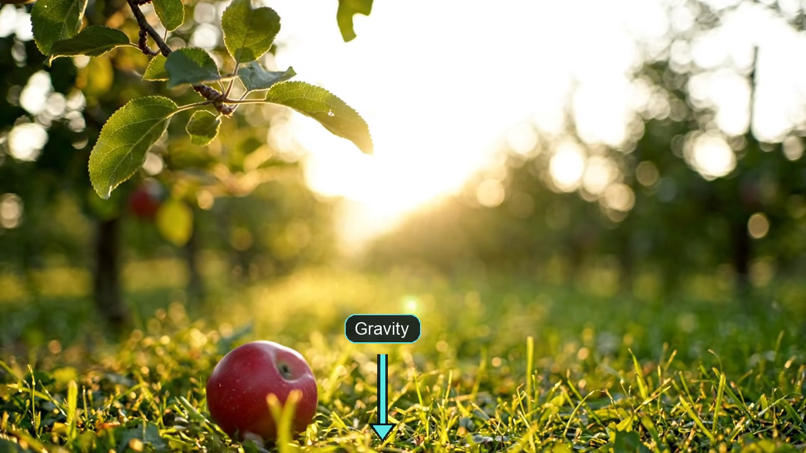

# Gravity overlay lab

A small, self-contained example of adding an educational graphic to a Google
Flow clip. Start with the apple video, track the red apple, draw a downward
arrow and the label **Gravity**, then composite that overlay onto the original
video while keeping its audio.

This repository is for learning and experimentation. It does not contain the
tooling used to produce the companion YouTube showcase.



## What is included

- `prompts/` — the initial request and example prompts for Google Flow and the
  overlay step.
- `assets/video/apple-source.mp4` — the example source clip.
- `assets/video/apple-gravity-example.mp4` — the finished example.
- `assets/images/` — the preview image and an idea-discussion picture used in
  the showcase.
- `overlay_gravity.py` — the Python script that creates the overlay.
- `requirements.txt` — the one Python package used by the script.

The Google Flow prompt is a reusable starter based on the example clip; the
exact wording of the original generated prompt was not retained. The overlay
prompt is the wording used for this example.

## Try it

You need Python 3.9 or later, FFmpeg, and FFprobe. FFmpeg and FFprobe must be
available on your `PATH`.

Create an environment and install the Python dependency:

```bash
python3 -m venv .venv
source .venv/bin/activate
python -m pip install -r requirements.txt
```

Run the included clip:

```bash
python overlay_gravity.py
```

The rendered video and a review still are written to the ignored `output/`
folder. To use a video you made in Google Flow, put it in `assets/video/` and
pass its path:

```bash
python overlay_gravity.py \
  --input assets/video/my-flow-clip.mp4 \
  --output output/my-flow-clip-with-gravity.mp4
```

To choose a different preview frame or font:

```bash
python overlay_gravity.py \
  --input assets/video/my-flow-clip.mp4 \
  --output output/my-flow-clip-with-gravity.mp4 \
  --preview-time 3.5 \
  --font /path/to/a-font.ttf
```

Run the commands from the repository root. Existing output files are
overwritten.

## How the code works

1. **Read the clip metadata.** FFprobe supplies the video dimensions, duration,
   frame rate, and whether it has audio.
2. **Sample frames.** FFmpeg creates a small set of low-resolution frames.
   Sampling keeps the tracking step quick.
3. **Find the apple.** Pillow checks each sampled pixel for a red colour
   signature, groups adjacent matching pixels, and uses the largest group as
   the apple's approximate centre.
4. **Fill in positions between samples.** Linear interpolation estimates the
   apple's position for every output frame.
5. **Draw the overlay.** Pillow creates a transparent frame with a cyan
   downward arrow and a dark-backed `Gravity` label positioned beside the
   apple.
6. **Composite the result.** FFmpeg overlays those frames on the source video,
   encodes the video, and copies the original audio stream when present.

The tracking is deliberately simple and inspectable; it is **not** a general
object-tracking model. It works best when there is one clearly visible red
apple, the camera is steady, and the clip has no cuts. If your Flow result
uses a differently coloured apple or another object, the red-pixel detector
may need to be adjusted in `apple_center()`. If there are multiple red objects,
the largest red region is selected.

The output resolution and frame rate follow the source clip. The sample assets
are 1280×720 at 24 fps.

## Assets and sharing

The sample image and videos are supplied for this project. Their inclusion
does not grant permission to reuse, publish, or redistribute them elsewhere.
Check the relevant rights before making this repository public or sharing the
media beyond its intended audience. The Python example has no separate
open-source licence attached.
